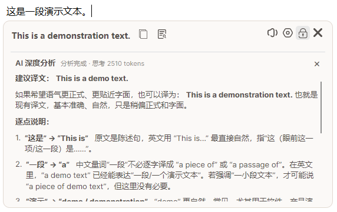
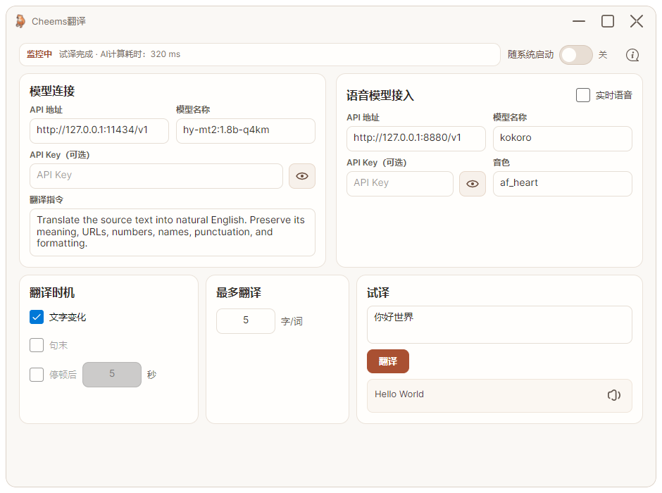
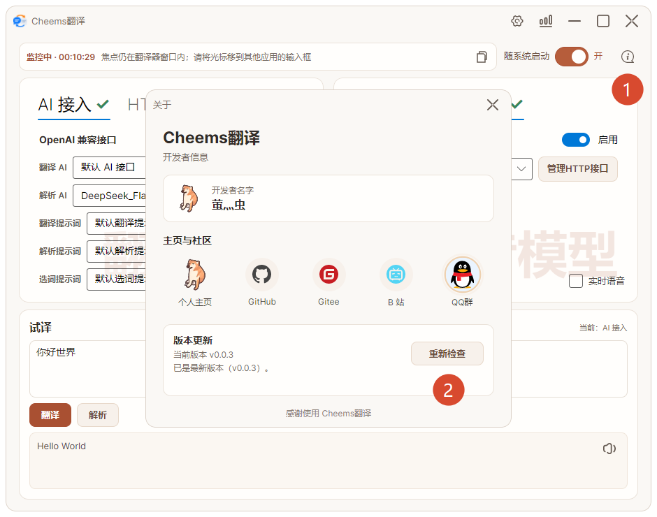

<div align="center">

# Cheems翻译

[](https://qm.qq.com/q/gmOiP7PLnW)
[](https://github.com/firebugbugs/CheemsAutoTranslate)
[](https://gitee.com/unbengable/cheems-auto-translate)

</div>

## 最新版下载

| 系统 | 最新版本 | Gitee 下载 | GitHub 下载 |
| --- | --- | --- | --- |
| Windows（x64） | v0.0.5 | [下载安装包（EXE）](https://gitee.com/unbengable/cheems-auto-translate/releases/download/v0.0.5/CheemsTranslator-v0.0.5-Setup.exe) | [下载安装包（EXE）](https://github.com/firebugbugs/CheemsAutoTranslate/releases/download/v0.0.5/CheemsTranslator-v0.0.5-Setup.exe) |
| Android（9 及以上） | v0.0.4 | [下载安装包（APK）](https://gitee.com/unbengable/cheems-auto-translate/releases/download/v0.0.4/CheemsTranslator-Android-v0.0.4.apk) | [下载安装包（APK）](https://github.com/firebugbugs/CheemsAutoTranslate/releases/download/v0.0.4/CheemsTranslator-Android-v0.0.4.apk) |

Android 版的首次使用与权限设置见[移动端使用说明](./mobile/README.md)。

<div align="center">





> 📣 **软件功能建议可以加QQ群联系群主。Windows 版支持软件内更新，Android 版请下载安装包更新。**



</div>

## 简介

Cheems翻译提供 Windows 桌面版和 Android 手机版，可自动识别输入内容并显示翻译浮层，支持 OpenAI 兼容模型和语音播报。

- 🌐 自动监控输入内容，实时显示翻译结果
- 🤖 支持 OpenAI 兼容接口，可连接本地模型
- 🔊 支持语音播报和手动朗读译文

## 本地模型配置

仓库提供 Ollama 的 Hy-MT2 模型配置：[Modelfile.Hy-MT2](docs/models/Modelfile.Hy-MT2)。可在仓库根目录运行以下命令创建本地模型：

```powershell
ollama create hy-mt2-translate -f docs/models/Modelfile.Hy-MT2
```
