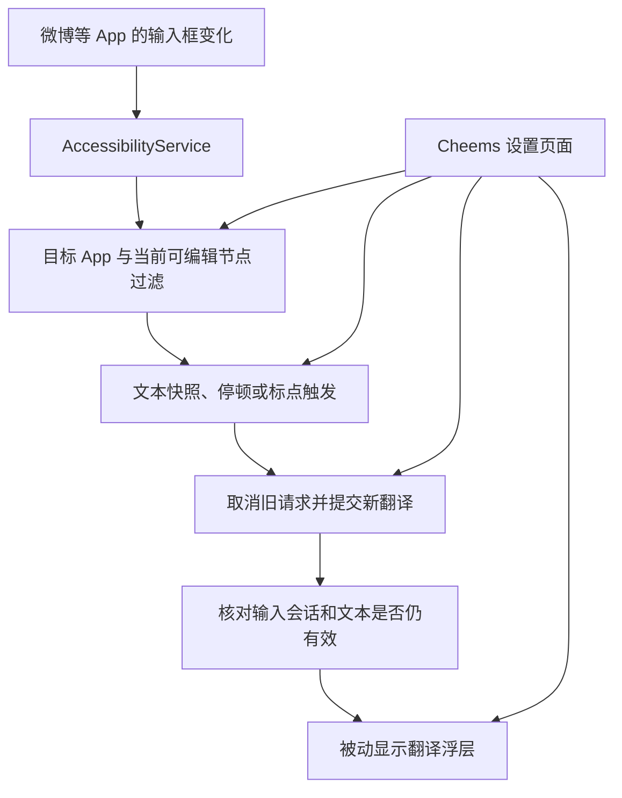

# Cheems 翻译移动端：输入监听、翻译浮窗与技术选型

调研日期：2026-10-14
现有桌面代码基线：`28de5b2582c97be873bfc97bd34ad0daf8ffc846`，版本 `v0.0.4`
调研范围：现有代码审阅、当前 Windows 开发环境检查、Android / Apple / 框架官方资料核对。尚未进行微博等 App 的手机实机验证。以下“建议”“原型目标”属于工程判断，不代表已实现或已通过应用商店审核。

## 1. 已确认的需求与选型结论

用户希望继续使用手机上现有的输入法。在微博等第三方 App 的输入框里输入文字时，Cheems 自动识别这段文字、调用翻译服务，并在不抢焦点、不影响打字和点击的浮窗里显示译文。

因此，产品的核心是**跨 App 的输入框监听与被动翻译浮层**。自定义翻译键盘不作为本次主方案；中文拼音引擎也不属于本次需求。

**建议优先做 Android 原生版本：Kotlin + Jetpack Compose 主页面 + AccessibilityService 输入监听 + WindowManager 无障碍浮层。** 翻译网络层使用 Kotlin 协程、Ktor Client 和 kotlinx.serialization。原生实现能够直接处理服务生命周期、窗口、输入法与系统权限，比较贴合这个项目的主要难点。

**iOS 无法通过普通第三方 App 的公开能力复现上述完整体验。** Apple 对第三方 App 实行沙箱隔离；跨 App 数据只能通过系统明确提供的机制获得。系统扩展也运行在指定的扩展场景中。根据这些能力边界，不能把 iOS 的普通 App 设计成持续监听微博输入框、在微博上方显示任意翻译浮窗的工具。这是平台可行性结论，换 Flutter、React Native、MAUI 或 KMP 不会获得额外的系统权限。[Apple：iOS 运行时安全](https://support.apple.com/en-gb/guide/security/sec15bfe098e/web)、[Apple：App Extension 工作方式](https://developer.apple.com/library/archive/documentation/General/Conceptual/ExtensibilityPG/ExtensionOverview.html)

产品路线建议为：

| 平台 | 建议定位 | 与当前需求的关系 |
| --- | --- | --- |
| Android | 自动监听输入框、被动浮窗翻译 | 有实现路径，覆盖范围必须实机确认 |
| iOS | 用户主动分享或粘贴文本的翻译辅助版 | 需要接受交互差异，不能宣称与 Android 功能一致 |

如果 iOS 必须做到完全相同的自动监听与浮窗，应先暂停 iOS 的该项开发承诺。若接受辅助版，可再安排 iOS App 与翻译扩展。

## 2. 现有 Windows 代码能复用什么

当前项目并不是可直接切换目标平台的通用移动端工程。主要依赖如下：

| 现有模块 | 已发现的实现 | 移动端处理建议 |
| --- | --- | --- |
| 项目与界面 | `net10.0-windows`、Avalonia Desktop、WPF、Windows Forms | 新建独立工程，按手机交互重新设计 |
| 输入监听 | `InputMonitor.cs` 使用 UI Automation、Win32、剪贴板序列号等能力；另有 Office 输入适配 | Android 改用无障碍事件与节点；iOS 没有对应的全局读取入口 |
| 翻译与解析 | `TranslationService.cs` 使用 HTTP、流式响应、提示词、输出长度处理 | 复用协议和行为设计，移植为独立移动端网络模块 |
| HTTP 档案 | 请求模板、鉴权、响应解析、同步 / 异步工作流 | 可沿用档案概念与 JSON 结构，先实现常用协议 |
| 语音 | NAudio / WASAPI / Media Foundation、Windows 播放器、EdgeTTS.DotNet | 重新接入平台语音与音频播放；现有播放器不能直接搬到手机 |
| 设置与密钥 | JSON 设置文件、Windows DPAPI 加密 | 手机采用自己的安全存储；DPAPI 密文不能直接导入手机使用 |
| 用量统计 | Microsoft.Data.Sqlite | 可沿用统计字段与口径，数据库实现独立适配 |
| 安装与更新 | Windows EXE 与桌面更新流程 | Android / iOS 分别建立签名和发布流程 |

代码位置：

- [项目配置](E:/Code/CheemsAutoTranslate/CursorTranslator/CursorTranslator.csproj)
- [输入监听](E:/Code/CheemsAutoTranslate/CursorTranslator/Services/InputMonitor.cs)
- [翻译服务](E:/Code/CheemsAutoTranslate/CursorTranslator/Services/TranslationService.cs)
- [语音服务](E:/Code/CheemsAutoTranslate/CursorTranslator/Services/SpeechSynthesisService.cs)
- [设置存储](E:/Code/CheemsAutoTranslate/CursorTranslator/Services/SettingsStore.cs)
- [统计存储](E:/Code/CheemsAutoTranslate/CursorTranslator/Services/UsageStatisticsStore.cs)
- [HTTP 语音档案说明](E:/Code/CheemsAutoTranslate/docs/speech-http-profiles.md)

最有价值的复用对象是提示词、接口档案、翻译规则、错误处理经验、图标资源和统计定义。移动端可以独立移植这些内容，无需修改 Windows 工程或让手机工程引用 Windows 项目。

## 3. Android 与 iOS 的能力边界

| 能力 | Android | iOS |
| --- | --- | --- |
| 保留用户原有输入法 | 可以，监听来自目标 App 的无障碍事件 | 可以正常使用原有输入法，但 Cheems 无法因此获得输入文本 |
| 自动读取第三方输入框 | 对暴露可访问文本的输入框有实现路径 | 普通 App 无全局输入框读取接口 |
| 跨 App 翻译浮层 | 可由无障碍服务或获授权的普通悬浮窗实现 | 普通 App 无任意跨 App 浮窗接口 |
| 输入停顿 / 标点触发 | 在可读取的文本来源上实现 | 可在 Cheems 自己的输入页实现 |
| 普通 App 在后台持续读取剪贴板 | Android 10 起受限制，前台 App 和默认输入法有例外 | 不应设计成全局剪贴板监听入口 |
| 用户主动提供文本 | 分享、粘贴、App 内输入 | 粘贴、系统支持的分享 / 操作扩展 |
| AI 翻译、解析、接口配置、App 内朗读 | 可实现 | 可实现 |

Android 的技术依据是系统提供的 `AccessibilityService`、文本变化事件和窗口类型；它们的存在不保证每个第三方 App 都会提供可用文本。[Android：创建无障碍服务](https://developer.android.com/guide/topics/ui/accessibility/service)、[Android：文本变化事件](https://developer.android.com/reference/android/view/accessibility/AccessibilityEvent#TYPE_VIEW_TEXT_CHANGED)

剪贴板权限不能作为普通后台 App 自动获取所有输入内容的替代路线。[Android 10：剪贴板访问限制](https://developer.android.com/about/versions/10/privacy/changes#clipboard-data)

### 3.1 Android 覆盖范围需要验证

标准可编辑控件通常更容易识别；微博等 App 可能使用自定义控件、WebView 或不同编辑页面。事件中的 `source`、文本、焦点信息可能不完整，输入法正在组词时也可能产生多次变化。

Android 14 起，视图还可以通过 `accessibilityDataSensitive` 限制非无障碍工具服务的交互。因此，不能承诺“所有输入框都支持”。[Android：敏感无障碍数据属性](https://developer.android.com/reference/android/R.attr#accessibilityDataSensitive)

首个需要实机回答的问题是：**微博发帖、评论等目标页面，是否能持续提供当前输入框的可访问文本？** 该问题应先于完整设置页面、模型管理和统计页面的开发。

### 3.2 iOS 的替代产品形态

可以考虑一个 SwiftUI 翻译 App，支持粘贴、翻译、解析和朗读；另外使用系统支持的扩展接收用户主动提供的文本。

对于“把选中文字翻译成另一种语言”，Apple 的 Action Extension 文档明确包含此类用途，适合优先验证。扩展只能处理宿主 App 提供的数据，并由用户主动调用；微博是否提供相应入口和文本同样需要测试。[Apple：Action Extension](https://developer.apple.com/library/archive/documentation/General/Conceptual/ExtensibilityPG/Action.html)

自定义键盘也能访问其输入上下文，但需要用户切换到 Cheems 键盘，且不能在任意位置绘制窗口；这与本次保留现有输入法的需求不同。[Apple：自定义键盘](https://developer.apple.com/library/archive/documentation/General/Conceptual/ExtensibilityPG/CustomKeyboard.html)

## 4. 推荐的 Android 技术栈

| 层次 | 建议技术 | 用途与理由 |
| --- | --- | --- |
| 开发语言 | Kotlin | 直接使用 Android 服务、窗口与事件 API |
| 主 App 界面 | Jetpack Compose + Material 3 | 权限引导、模型设置、目标 App 列表、翻译试用、浮层预览 |
| 输入监听 | AccessibilityService | 读取允许监控的 App 中当前可编辑输入框的变化 |
| 浮层 | WindowManager + 轻量 Android View | 首先验证无障碍浮层；直接控制焦点、触摸与窗口大小 |
| 并发与状态 | Kotlin Coroutines + Flow / StateFlow | 防抖、取消请求、服务状态、只显示最新译文 |
| 网络 | Ktor Client，Android 使用 OkHttp 引擎 | HTTP 与流式翻译；为以后共享网络逻辑留出边界 |
| JSON | kotlinx.serialization | 接口档案、请求体、响应模型与配置导入 |
| 普通设置 | Jetpack DataStore | 保存小规模设置，适配协程与 Flow |
| 敏感配置 | Android Keystore 管理加密密钥，应用私有存储保存加密后的 API Key | 将密钥与普通配置分开 |
| 历史与统计 | 首版按需加入 Room / SQLite | 保存用量指标；原文历史单独由用户选择是否启用 |
| 朗读 | 平台 TTS；自定义 HTTP TTS 后续接入 | 语音可用性取决于系统引擎与安装的语音资源 |
| 构建发布 | Gradle、Android Studio、APK / AAB 签名 | 本地安装验证与后续分发 |

Ktor 支持 Android 与 Apple 平台的不同网络引擎；DataStore 适合小规模设置，复杂结构化数据可使用 Room。[Ktor：客户端引擎](https://ktor.io/docs/client-engines.html)、[Android：DataStore](https://developer.android.com/topic/libraries/architecture/datastore)、[Android：Room](https://developer.android.com/training/data-storage/room)

Keystore 主要保护加密密钥，并非直接存放任意 API Key 字符串的普通配置库。[Android：Keystore](https://developer.android.com/privacy-and-security/keystore)

### 4.1 数据流设计



建议关注 `TYPE_VIEW_TEXT_CHANGED`、焦点变化和窗口切换事件。仅在必要时补充节点变化处理，限制节点查询范围和频率。无障碍服务通过 `canRetrieveWindowContent` 获得所需的节点读取能力；服务由系统绑定，并由用户在系统设置中启用。[Android：无障碍服务配置](https://developer.android.com/guide/topics/ui/accessibility/service)

应用层建议采用以下规则：

1. 用户选择允许自动翻译的目标 App，监听该 App 当前输入框。
2. 检测密码字段、无法确认的来源和已失效节点，立即跳过或隐藏浮层。
3. 对文本变化做停顿防抖，并支持中文和英文常见标点触发，包括逗号。
4. 请求携带输入会话与文本版本；用户继续输入、切换 App 或输入框时取消旧任务。
5. 响应完成后再次核对来源，避免把上一段文本的译文显示在新输入框上。
6. 译文只展示；首版没有自动修改、替换或发送宿主 App 文本的行为。

建议原型停顿阈值从 **1 秒**开始试用，再提供可调参数。这里是手机端的新建议，应以中文组词期间的实际表现校准。长文长度上限、请求次数和流式更新频率也需要单独控制。

### 4.2 “不干扰用户操作”应如何实现

建议先验证由已连接无障碍服务创建的 `TYPE_ACCESSIBILITY_OVERLAY`，并使用 `FLAG_NOT_FOCUSABLE` 与 `FLAG_NOT_TOUCHABLE`。前者避免窗口取得输入焦点，后者使浮层不接收触摸；原型仍需检查系统实际传递触摸的行为。[Android：窗口类型与标志](https://developer.android.com/reference/android/view/WindowManager.LayoutParams)

Android 12 的触摸安全规则将无障碍窗口视为可信窗口，普通 `TYPE_APPLICATION_OVERLAY` 不属于这类窗口。因此，无障碍浮层值得作为首个原型路线。[Android 12：不可信触摸事件及例外](https://developer.android.com/about/versions/12/behavior-changes-all#untrusted-touch-events)

如果改用普通应用悬浮窗，需要 `SYSTEM_ALERT_WINDOW` 授权，并处理透明度导致的触摸阻挡：Android 文档中的最大遮挡不透明度为 0.8，也提供系统查询接口；重叠窗口还涉及组合遮挡程度。普通应用悬浮窗位于输入法等关键系统窗口之下。[Android：普通悬浮窗与触摸安全规则](https://developer.android.com/reference/android/view/WindowManager.LayoutParams#FLAG_NOT_TOUCHABLE)

浮层交互建议：

- 默认仅展示译文，位置预先在设置页调整。
- 使用内容所需的小窗口范围，避免铺设整屏透明容器。
- 根据输入框、键盘和屏幕安全区域选择位置，尽量避免视觉遮挡正在输入的文字。
- 输入框清空、来源切换或服务暂停时及时清除旧译文。
- 暂停、位置调整和外观修改放在主 App 或明确的控制入口。

完全触摸穿透的浮层自身无法同时支持拖动、复制和点击朗读。若以后增加交互模式，应由用户主动进入，并说明操作范围。

## 5. 技术栈比较

以下比较针对“跨 App 输入监听与浮窗”，不是通用 App 框架排名。工作量与适合程度属于本项目的判断。

| 方案 | 优点 | 本项目的主要成本 | 结论 |
| --- | --- | --- | --- |
| Android Kotlin 原生；iOS Swift 原生辅助版 | 系统 API、权限和生命周期控制直接；平台差异清晰 | 两套界面；部分网络逻辑可能重复 | **当前首选** |
| 原生平台模块 + KMP 共享翻译内核 | 提示词、请求、解析、取消和错误处理可共享 | 多平台构建、Swift 接口适配和调试有额外成本 | iOS 辅助版确定后可引入 |
| Flutter 主 App + Kotlin Android 服务 / 浮层 + Swift iOS 扩展 | 主 App 设置界面可共享；UI 开发便利 | 核心监听与浮层仍需原生实现，服务与 Dart 状态需要协调 | 两端独立 App 功能扩大时再评估 |
| React Native + 原生模块 | TypeScript 页面与原生 API 可结合 | Android 服务不能依赖页面 JS 生命周期；需要额外原生模块 | 当前未体现比原生更明显的收益 |
| .NET MAUI + 平台代码 | C# 开发经验与部分纯网络代码较容易沿用 | Windows 监听与音频必须重写；服务、窗口和扩展仍需平台适配 | 可行备选，优先级较低 |
| Avalonia Mobile + 平台代码 | 既有 C# / XAML 经验有价值，框架支持 Android / iOS | 当前工程绑定 Windows；桌面浮窗行为不等于手机系统浮层 | 不能直接将现有工程改目标后发布 |

Flutter 和 React Native 都提供原生接入机制，MAUI 与 Avalonia 都支持移动端。上述优先级来自本项目系统集成所占的比重，不是框架缺少 Android / iOS 支持。[Flutter：平台代码](https://docs.flutter.dev/platform-integration/platform-channels)、[React Native：原生模块](https://reactnative.dev/docs/turbo-native-modules-introduction)、[MAUI：平台支持](https://learn.microsoft.com/en-us/dotnet/maui/supported-platforms)、[Avalonia：平台支持](https://docs.avaloniaui.net/docs/supported-platforms)

### KMP 的合理使用边界

若确定制作 iOS 辅助版，可以将翻译协议、HTTP 档案、提示词、流式响应、取消和错误模型放进 KMP 共享模块。Android 无障碍服务、窗口操作和 iOS 扩展生命周期由原生代码负责。KMP 支持共享业务逻辑并保留原生界面。[Kotlin：多平台项目组织](https://kotlinlang.org/docs/multiplatform/multiplatform-project-configuration.html)

原型阶段先让 Android 的翻译模块独立于服务和 UI。是否引入 KMP，可以在 iOS 产品形态确定后决定，避免先建立复杂工程却尚未证明核心输入来源可读。

## 6. 权限、数据与分发的实际影响

### 6.1 无障碍服务与商店审核

Google Play 允许符合要求的 App 使用 AccessibilityService，但非面向残障用户的无障碍工具需要清晰的应用内披露、用户明确同意及相应声明。翻译工具不能仅为获得更大访问范围就将自己标记为 `isAccessibilityTool=true`；该标记应符合实际产品用途。是否获准上架，需要依实际用途和审核材料判断。[Google Play：AccessibilityService API 政策](https://support.google.com/googleplay/android-developer/answer/10964491)

产品引导需要清楚说明：读取的是哪些目标 App 的输入内容、何时提交翻译、发送到哪个服务。获取文本的系统权限与将文本提交到 AI 服务的用户同意，应在使用流程里让用户理解。

直接发布 APK 也可能遇到系统对受限设置的提示，不能假设安装后就能立即启用无障碍服务。不同安装来源和设备需要验证。[Android：受限设置](https://support.google.com/android/answer/12623953)

### 6.2 配置与输入数据

建议默认采用用户自行配置接口的模式，与现有桌面端保持一致；首版无需建设自己的账号、计费和模型中转服务器。

- 自动翻译仅在用户启用的目标 App 中工作。
- 不将原始输入默认写入日志或统计库；记录次数、耗时、错误类型等指标即可。
- API Key 不进入代码仓库、分享文件或普通明文配置。
- 档案导入优先处理不包含密钥的 JSON，密钥在手机端重新填写。
- 手机使用桌面上的本地模型时，需要能访问的局域网或服务器地址；手机的 `127.0.0.1` 指向手机自身。
- 上线使用 HTTPS；开发环境中的本地 HTTP 接口需要另行配置并验证平台网络策略。

若制作 iOS App 与 Action Extension，普通配置可通过 App Groups 共享，敏感信息通过适当的 Keychain 访问组共享；这只适用于自己的 App 与扩展。[Apple：共享 Keychain 数据](https://developer.apple.com/documentation/security/sharing-access-to-keychain-items-among-a-collection-of-apps)

## 7. 新工程的目录建议

移动端采用独立代码目录，后续可建立独立 Git 仓库、包名、版本号和发布流程。

```text
E:\Code\
├─ CheemsAutoTranslate\                 # 现有 Windows 项目
└─ CheemsAutoTranslateMobile\           # 新移动端项目
   ├─ docs\
   │  └─ 移动端技术栈与可行性分析.md
   ├─ androidApp\                      # 后续创建：Android 原生工程
   │  └─ ...
   │     ├─ accessibility\             # 输入节点识别、事件与会话
   │     ├─ overlay\                   # 被动浮层与窗口生命周期
   │     ├─ translation\               # 请求、流式解析与取消
   │     ├─ settings\                  # 档案、权限与目标 App 设置
   │     └─ ui\                        # Compose 主页面
   ├─ shared\                          # 可选：后续 KMP 共享业务模块
   ├─ iosApp\                          # 产品方案确认后创建：辅助版
   │  ├─ App\
   │  └─ TranslationActionExtension\
   └─ schemas\                         # 后续：接口档案的数据约定
```

本次分析后已开始在独立目录 `E:\Code\CheemsAutoTranslateMobile` 搭建 Android 原型，桌面版目录保持独立。

## 8. 当前开发环境与构建要求

本机为 Windows；已确认 Android Studio、其 JBR 21.0.10、Android SDK 平台 36 / 36.1、Build Tools 和 ADB 已安装。Java 与 ADB 未加入当前进程的 PATH，需要显式指定工具路径或从 Android Studio 执行。SDK 命令行工具目录未在常见路径中找到。

原型采用 Android Gradle Plugin 8.13.2、Kotlin 2.3.21、Compose 1.10.6、Activity 1.12.4、Core 1.18.0、DataStore 1.2.1 与 Ktor 3.3.3。首次构建发现 Compose 1.12.1 / Core 1.19.0 要求 API 37 与 AGP 9.1，因此已调到本机 API 36 工具链可用的依赖组合。`assembleDebug` 已使用本机缓存的 Gradle 9.4.1 成功，APK 已生成。项目 Wrapper 配置为 Android Gradle Plugin 8.13 所需的 Gradle 8.13，但此环境下载 130 MB 的官方发行包速度过慢，尚未完成 Wrapper 版本复建验证。已在雷电模拟器 Android 9 / API 28（x86_64）安装启动，并用本地模拟接口验证浏览器输入框的文本监听、浮窗展示和点击穿透。

当前原型最低版本设为 **Android 9 / API 28**，这是为了覆盖本机雷电模拟器并通过启动验证；仍需在实际手机、微博等目标 App 上复测，不代表已验证所有 Android 9 设备或输入框。

iOS 构建和实机调试需要 macOS 与 Xcode；Windows 上不能完成完整本地 iOS 构建流程，可使用自己的 Mac 或合适的远程 macOS 构建环境。KMP 与 MAUI 的官方资料也明确说明相应 Mac 要求。[Kotlin：环境准备](https://kotlinlang.org/docs/multiplatform/quickstart.html)、[MAUI：iOS 开发环境](https://learn.microsoft.com/en-us/dotnet/maui/supported-platforms)

Android 原型的具体依赖组合以 `androidApp/gradle/libs.versions.toml` 为准，需由 Gradle 构建继续验证；iOS 端依据实际使用的 Xcode 和发布要求匹配。

## 9. 建议开发顺序与原型验收

### 第一步：只证明 Android 核心路径

先创建最小 Android 原型，使用固定的本地示例译文验证窗口；输入来源和浮层稳定后，再接一个实际翻译接口。首轮要证明：

| 验证项 | 需要观察的结果 |
| --- | --- |
| 微博发帖输入 | 使用原有输入法，能取得当前可读文本的更新 |
| 微博评论输入 | 不同页面分别验证，不把发帖结果推定到所有输入框 |
| 中文拼音组词与候选选择 | 不因组词过程频繁翻译错误片段 |
| 字母、逗号、句号与停顿 | 触发与用户设置一致，连续输入不会积压请求 |
| 点击浮层覆盖的位置 | 被动模式下下方 App 仍能接收操作 |
| 焦点与键盘 | 显示和更新译文时键盘不收起、光标不跳动 |
| App 或输入框切换 | 旧请求取消，旧译文清除，不显示错误来源的结果 |
| 删除、粘贴、长文本 | 显示当前版本，长度与请求量受控 |
| 密码、敏感输入和不可读节点 | 跳过，不提交翻译请求 |
| 锁屏、旋转、服务关闭与恢复 | 窗口正确清理，状态明确 |
| 不同 Android 版本和品牌 | 至少涵盖 Android 12+ 的触摸规则与一台目标品牌真机 |

其中“微博可读取文本”和“浮层不干扰操作”是继续建设完整 Android 产品的前提。某个目标 App 不暴露节点时，应列为不支持或限制支持，不能用一个标准测试输入框的成功代表所有 App。

### 第二步：补齐 Android 可用版

核心原型成立后，加入模型档案、翻译触发方式、目标 App 列表、权限状态、浮层位置与外观、暂停入口、错误提示和可选语音。深度解析、复杂 HTTP 工作流与历史统计可以后续扩展。

### 第三步：明确 iOS 的可接受交互

开发 iOS 代码之前，需要确认用户是否接受“主动提供文本后翻译”的辅助版。接受后再验证 Action Extension 的宿主支持范围，并决定是否引入 KMP 共用翻译内核。

## 10. 需要在正式开发前落实的事项

1. Android 实机与微博目标页面的可访问文本验证。
2. 无障碍浮层的焦点、触摸穿透、位置和服务生命周期验证。
3. 首发渠道：直接分发 APK、国内应用市场或 Google Play；据此安排权限引导与审核材料。
4. iOS 是否接受辅助版，以及可用的 Mac / Xcode 构建环境。

最终建议是以 **Android 原生监听与浮层原型**作为下一步，先确认用户描述的实际操作路径能够成立；iOS 在产品交互差异确认后进入独立实现阶段。
